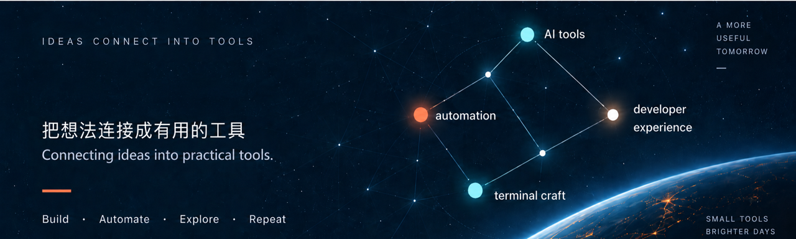

  

## Featured projects

Some things I'm building and exploring.

<table>
  <tr>
    <td width="48" align="center"></td>
    <td><strong><a href="https://github.com/jumpersun/ghostty-starship">ghostty-starship</a></strong> 面向 macOS 的 Ghostty + Starship 终端配置，提供快速安装。</td>
    <td>Shell · Public</td>
  </tr>
  <tr>
    <td width="48" align="center"></td>
    <td><strong><a href="https://github.com/jumpersun/chat">chat</a></strong> 基于 React、FastAPI 与 OpenAI API 的流式多会话聊天应用。</td>
    <td>TypeScript · Python</td>
  </tr>
  <tr>
    <td width="48" align="center"></td>
    <td><strong><a href="https://github.com/jumpersun/ai-saas-template">ai-saas-template</a></strong> 用于研究 Next.js 15 AI SaaS 架构的参考 fork。</td>
    <td>TypeScript · Fork</td>
  </tr>
</table>

## Exploring now

- AI-assisted developer tools
- Workflow automation
- Calmer terminal and developer experiences

## Connect

[github.com/jumpersun](https://github.com/jumpersun)

Build · Automate · Explore · Repeat

